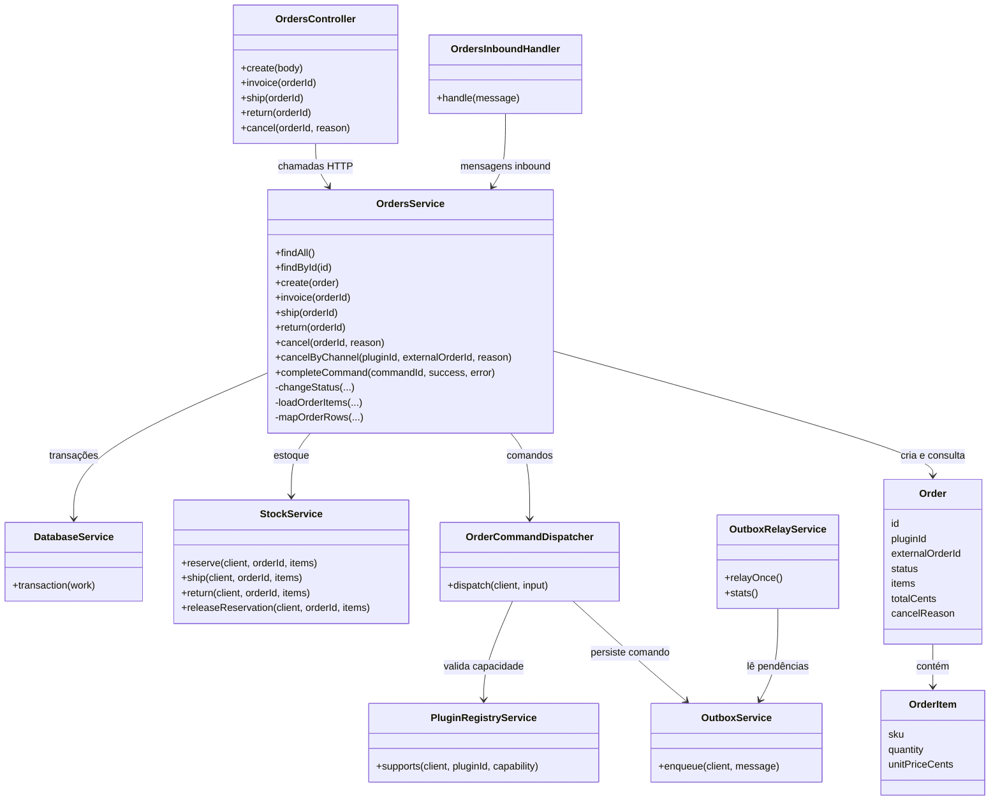
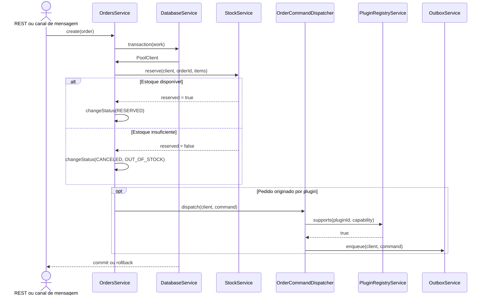
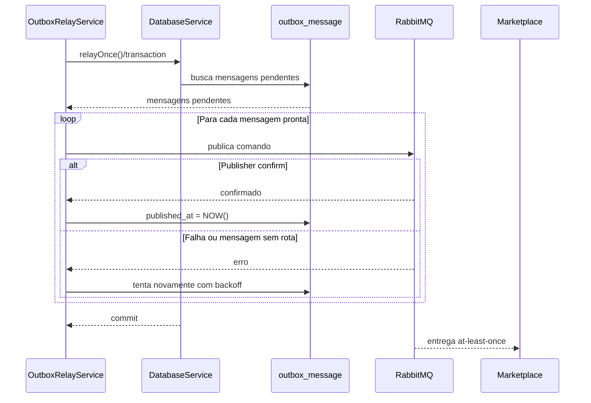
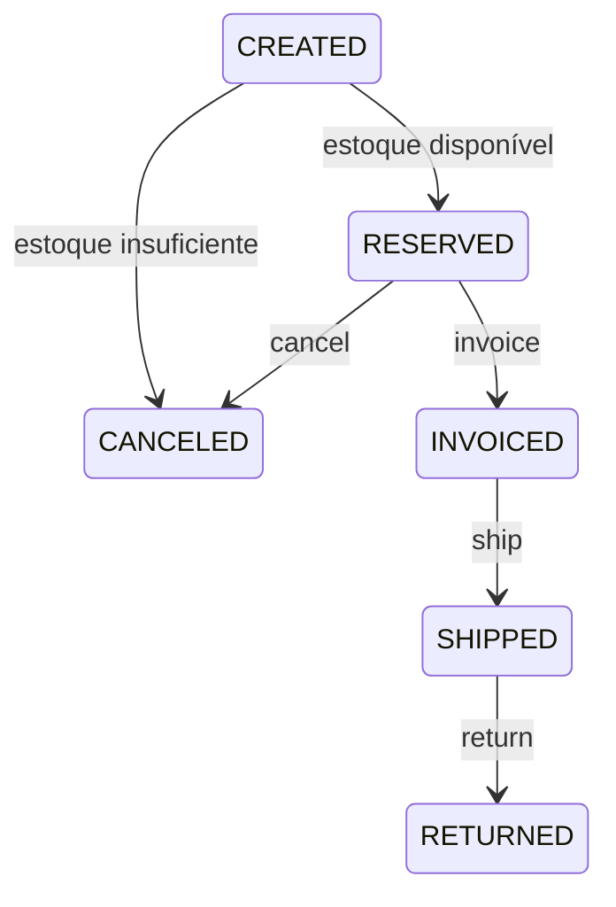

# C4 nível 4 — Código do módulo de pedidos

Este documento descreve as principais classes envolvidas no ciclo de vida de
um pedido no `core`. O foco é mostrar responsabilidades e dependências
relevantes para o negócio, sem detalhar cada DTO, linha SQL ou tipo privado de
persistência.

## Escopo

O fluxo documentado cobre:

- entrada de um novo pedido;
- reserva de estoque;
- transições de status;
- faturamento, envio, devolução e cancelamento;
- geração de comandos para plugins;
- confirmação do processamento de comandos.

## Diagrama de classes

## Diagrama de sequência: criação de pedido

## Diagrama de sequência: publicação pelo outbox

## Responsabilidades

### `OrdersController`

Recebe operações HTTP e delega o processamento ao `OrdersService`. Não
implementa regras de transição nem acessa diretamente o banco.

### `OrdersInboundHandler`

Converte mensagens recebidas dos plugins em operações do `OrdersService`:

- `ORDER_RECEIVED` cria um pedido;
- `ORDER_CANCELED_BY_CHANNEL` cancela um pedido pelo identificador externo;
- `COMMAND_PROCESSED` atualiza o resultado de um comando pendente.

### `OrdersService`

É o orquestrador do domínio de pedidos. Suas responsabilidades principais
são:

1. persistir o pedido e seus itens;
2. calcular o total do pedido;
3. coordenar a reserva e as movimentações de estoque;
4. validar e persistir as transições de status;
5. criar comandos quando uma transição precisa notificar um plugin;
6. garantir idempotência em criação e cancelamento;
7. mapear linhas relacionais do banco para o modelo `Order`.

A alteração de status é protegida por bloqueio da linha do pedido (`FOR
UPDATE`) e pelo mapa de transições permitidas.

### `DatabaseService`

Executa uma operação dentro de uma transação PostgreSQL. Em caso de conflito
de versão de estoque, desfaz a operação e tenta novamente até o limite
configurado.

### `StockService`

Calcula a disponibilidade e registra os eventos de estoque necessários para:

- reservar itens na criação do pedido;
- liberar uma reserva no cancelamento;
- registrar a saída no envio;
- registrar a devolução.

As operações recebem o mesmo `PoolClient` da transação do pedido para manter a
alteração atômica.

### `OrderCommandDispatcher`

Valida se o plugin suporta a capacidade correspondente ao comando e grava o
comando no outbox. Os comandos de pedido são:

- `INVOICE_ORDER`;
- `SHIP_ORDER`;
- `RETURN_ORDER`;
- `CANCEL_ORDER`.

### `PluginRegistryService`

Consulta os plugins registrados e verifica se o plugin de destino suporta a
capacidade necessária para o comando.

### `OutboxService`

Persiste a mensagem na tabela `outbox_message`. A publicação no broker ocorre
posteriormente pelo relay, evitando o problema de gravar no banco e publicar
no broker como duas operações independentes.

## Máquina de estados do pedido

Estados terminais:

- `RETURNED`;
- `CANCELED`.

Uma transição inválida gera erro de conflito e não altera o pedido.

## Fluxos principais

### Criação de pedido

1. `OrdersController` ou `OrdersInboundHandler` chama `create`.
2. `OrdersService` insere o pedido e seus itens.
3. `StockService` tenta reservar os itens.
4. Se a reserva funcionar, o pedido vai para `RESERVED`.
5. Se não houver estoque, o pedido vai para `CANCELED` com motivo
   `OUT_OF_STOCK`.
6. Se existir o mesmo pedido externo, a operação é ignorada.

### Mudança de status com comando

1. `OrdersService` bloqueia o pedido e valida a transição.
2. O novo status é persistido.
3. `OrderCommandDispatcher` verifica a capacidade do plugin.
4. `OutboxService` grava o comando na mesma transação.
5. O relay publica o comando posteriormente.

### Cancelamento

O cancelamento altera o status para `CANCELED`. Se o pedido estava em
`RESERVED`, o `StockService` também registra a liberação da reserva na mesma
transação.

## Fora do escopo deste diagrama

Os seguintes elementos são detalhes de implementação e não precisam aparecer
no diagrama principal:

- `OrderRow`;
- `LockedOrder`;
- `StockBalanceRow`;
- consultas SQL individuais;
- `Logger`;
- `Pool` e `PoolClient`;
- DTOs que apenas validam a entrada HTTP.

Esses detalhes podem ser adicionados em uma documentação específica de
persistência ou implementação caso sejam necessários para manutenção.
